# DataPilot · AI-Native 大数据平台

> **AI-Native 大数据平台**：引擎层用成熟开源（可插拔），平台层全自研；自然语言对话贯穿建任务、跑调度、查数据、管资产的全过程。
> 12 种数据源 · 8 大功能模块 · AI 横切层（13 个工具）· 列级脱敏 · 主机监控 · **90 个测试全绿**
> 📚 全套设计文档（11 篇：架构 / PRD / 排期 / 部署 / 验收）见 [docs/design/](docs/design/)

## 快速开始（单机，60 秒）

```bash
cd data-platform
python3 -m venv .venv && ./.venv/bin/pip install -r requirements.txt
./.venv/bin/uvicorn app.main:app --port 8100
# 浏览器: http://127.0.0.1:8100  （web/dist 存在时自动挂载前端）
```

默认账号：`admin/admin123` · `engineer/engineer123` · `analyst/analyst123` · `viewer/viewer123`

启动即自带演示环境：`demo_source`（SQLite 业务库：orders/customers）与 `demo_warehouse`（模拟数仓），
元数据已采集、类型映射知识库/术语表/问数样例已初始化。

**立刻体验 AI 对话**（未配 LLM 时走内置规则引擎，离线可用）：

```
把 demo_source 的 orders 表每天凌晨2点同步到 demo_warehouse 的 ods_orders   ← 建同步任务
查 demo_source 的 orders 前10行                                            ← 即席查询
基于 ods_orders 做 dwd 订单明细，剔除测试账号，每天凌晨3点跑                   ← 建 ETL
统计每天订单量                                                             ← 智能问数
```

创建类操作会先产出**草稿 + 试跑结果**，在对话里点「确认」才上线（HITL 红线）。

## 接入真实大模型（可选）

```bash
export AI_BASE_URL=https://api.deepseek.com/v1
export AI_API_KEY=sk-xxx
export AI_MODEL=deepseek-chat      # 任何 OpenAI 兼容接口（Qwen 等）均可
```

## 接入真实引擎（可选，默认内置执行器即可跑）

| 引擎 | 默认 | 生产接入方式 |
|---|---|---|
| 调度 | 内置 LocalScheduler（APScheduler） | `SCHEDULER_ENGINE=airflow` + `AIRFLOW_URL/TOKEN`，`deploy/airflow/factory_dag.py` 放入 dags 目录（配置驱动动态 DAG） |
| 同步 | 内置执行器（SQLAlchemy 跨源复制） | `DATAX_HOME=/opt/datax` 后渲染 DataX JSON 由 datax.py 执行（任务版本页可查看渲染 JSON） |
| OLAP | SQLite 演示 | 数据源类型选 `doris`（MySQL 协议 9030）或 `mysql`/`postgres` |
| 平台库 | SQLite | `DATABASE_URL=mysql+pymysql://...` |

## 生产部署（Docker Compose）

```bash
cd deploy && cp .env.example .env   # 按需修改密码/LLM 配置
docker compose up -d                # MySQL + Doris(FE/BE) + Airflow + DataX + app + nginx
```

组件：`deploy/docker-compose.yml` · `deploy/airflow/factory_dag.py` · `deploy/nginx.conf` · `deploy/backup.sh`（建议 crontab 每日备份）。

**完整部署手册见 [DEPLOY.md](DEPLOY.md)**：环境变量全表、首次初始化检查清单、11 种数据源接入参数对照、调度引擎切换、备份恢复、升级步骤、常见问题与上线安全清单。

## 功能模块（M1-M4 全部交付）

| 模块 | 能力 | 测试 |
|---|---|---|
| 认证权限 | JWT + 4 角色 RBAC + 资源 Owner + 全量审计（ui/api/ai 三来源） | ✅ |
| 数据源 | **12 种**：MySQL / Doris / StarRocks / Oracle / ClickHouse / PostgreSQL / SQLite / **Hive** / **Spark** / **Trino** / **MaxCompute**(pyodps 通道) / **SQL Server**(驱动按需安装)，凭据 Fernet 加密；页内含 **Hadoop 平台** tab（集群注册+连通测试+一键派生数据源+Kerberos keytab） | ✅ |
| 元数据 | inspector 自动采集、注释/负责人人工补录、倒排索引搜索 | ✅ |
| 数据集成 | 结构化配置→校验链（连通/类型映射规则/列核对）→试跑100行→版本化→DataX JSON 渲染→发布/下线；**文件入仓**（UI 拖拽上传 CSV/Excel/TXT/JSON，类型推断+冲突策略）、**整库批量同步**、**源目数据比对** | ✅ |
| 数据调度 | Local/Airflow 双适配器、cron、跨工作流依赖（waiting+轮询）、实例/节点日志、重跑/暂停/恢复、失败告警（邮件/webhook） | ✅ |
| 数据开发 | SQL 任务（sqlglot 只读/INSERT...SELECT 白名单校验、EXPLAIN、CTAS 自动建表）、多节点拓扑编排、任务级血缘 | ✅ |
| 智能问数 | Agent loop（Function Calling）、元数据/术语/few-shot RAG 注入（**术语同义词族展开**：流水→GMV→orders）、结果自动出图；**知识库独立管理页**（SQL 示例/术语库，侧边栏子导航） | ✅ |
| 数据查询 | SQL 工作台：数据源/表清单、只读白名单校验、自动 LIMIT、结果分页、CSV 导出、查询历史、保存查询（全部角色自助取数） | ✅ |
| AI 建任务 | 13 个 AI 工具横切全部模块；**AI 助手独立页面**（左侧导航）+ 智能问数双入口；**多标签页导航**（多页并存/切换/可关闭）；上下文感知指令示范 | ✅ |
| 资产/地图 | 标签/Owner/资产目录、表详情（样例/上下游/相关工作流）、SVG 血缘图 | ✅ |
| 数据服务 | SQL 模板→API：AK/SK(HMAC) 签名、授权、限流、IP 白名单、缓存、审计日志、参数校验；**列级脱敏规则**（API/查询/问数出参统一生效，同步不受影响） | ✅ |
| BI 分析 | Superset 外挂集成（URL 配置 + 侧边栏动态入口），不自研报表引擎 | ✅ |
| 主机监控 | CPU/内存/磁盘/进程内存实时展示（10s 轮询），监控页独立 tab | ✅ |
| 数据监控告警 | 7 类规则（行数波动/阈值/空值率/唯一性/数据延迟/自定义SQL/任务时长）+ cron 定时巡检 + 概览看板 + 趋势图 + 分组 + 告警静默窗口 + 失败经告警通道通知 | ✅ |

测试：`./.venv/bin/python -m pytest tests/ -q` → **90 passed**（单元 + 全链路 e2e + 多轮审查回归）。

## 目录结构

```
app/
├── main.py            # 入口（种子、调度重建、前端挂载）
├── config.py          # 环境变量配置
├── security.py        # JWT/PBKDF2/Fernet
├── models/            # 9 组模型（auth/datasource/meta/integ/sched/apigw...）
├── services/
│   ├── engine_registry.py   # 多源引擎注册（mysql/doris/pg/sqlite）
│   ├── integ_service.py     # 校验链/类型映射/DataX渲染/内置执行器
│   ├── sched_service.py     # Local+Airflow 双调度适配器
│   ├── task_runner.py       # 拓扑执行/节点分发/成功后自动刷新元数据
│   ├── sqlguard.py          # sqlglot SQL 护栏
│   ├── llm.py               # OpenAI 兼容 LLM + 规则引擎兜底
│   ├── agent.py             # 工具注册/Agent Loop/HITL 确认流
│   ├── apigw_service.py     # 数据服务执行链路
│   └── asset_service.py     # 资产/地图/血缘图
├── routers/           # 9 组路由（87 端点）
└── seed.py            # 演示数据源/知识库/账号
web/                   # Vue3 + Element Plus 前端（构建产物 dist 由后端挂载）
deploy/                # docker-compose / airflow 工厂 / nginx / 备份
tests/                 # 30 个用例（单元 + e2e）
```

## 界面预览

<table>
<tr><td>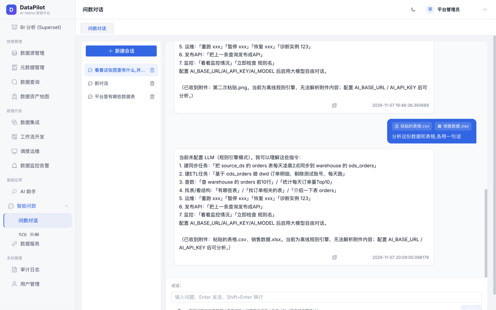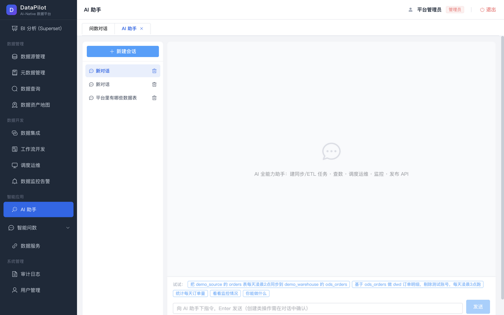</td></tr>
<tr><td colspan="2"><b>智能问数（RAG：术语同义词族展开 + few-shot）</b> · <b>AI 全能力助手（13 个工具横切全模块）</b></td></tr>
<tr><td>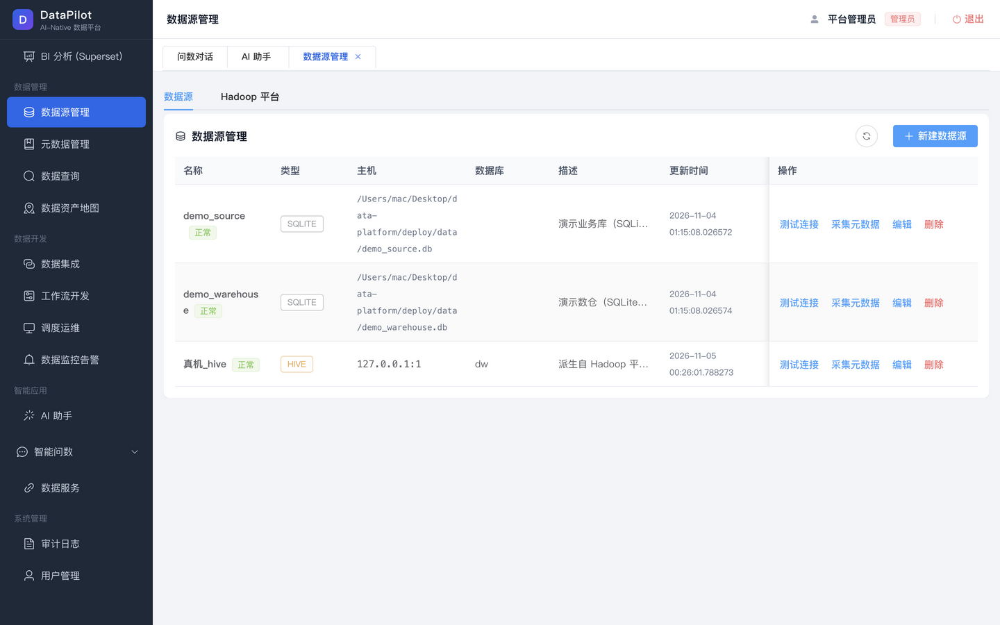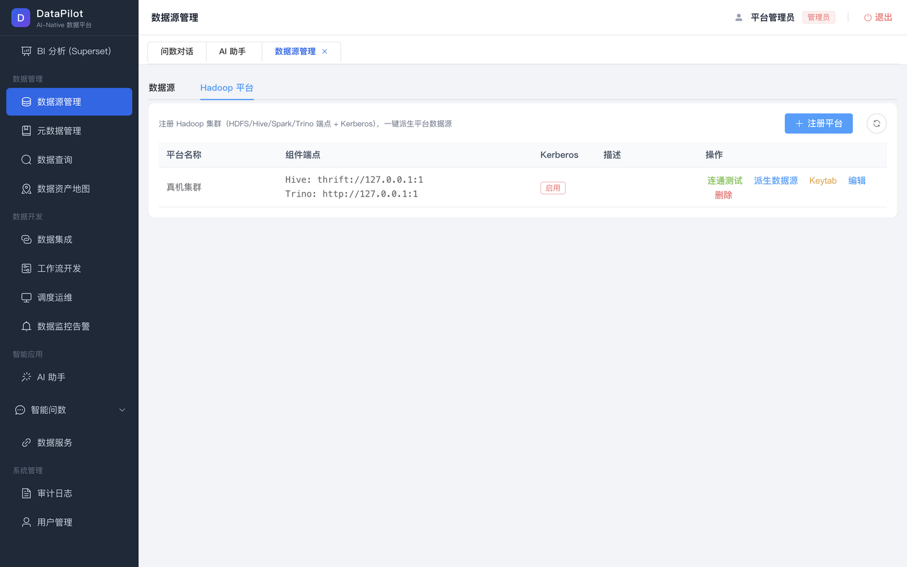</td></tr>
<tr><td colspan="2"><b>12 种数据源</b> · <b>Hadoop 平台</b>（集群注册 / 连通测试 / 一键派生 / Kerberos keytab）</td></tr>
<tr><td>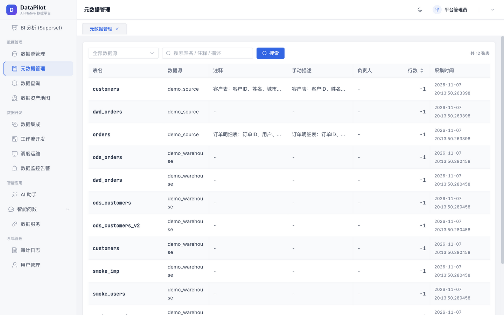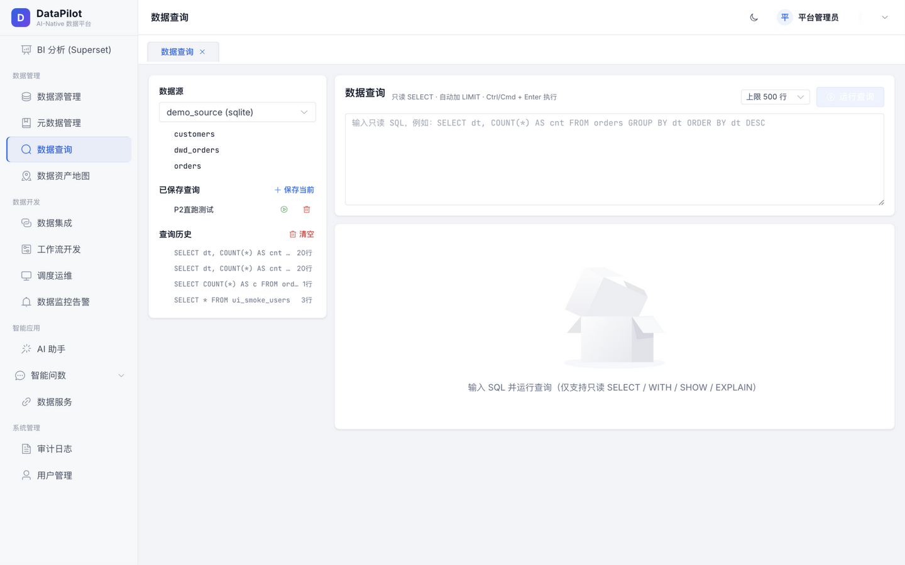</td></tr>
<tr><td colspan="2"><b>元数据管理（采集 / 注释 / 负责人）</b> · <b>数据查询工作台（只读护栏 / 自动 LIMIT / CSV 导出）</b></td></tr>
<tr><td>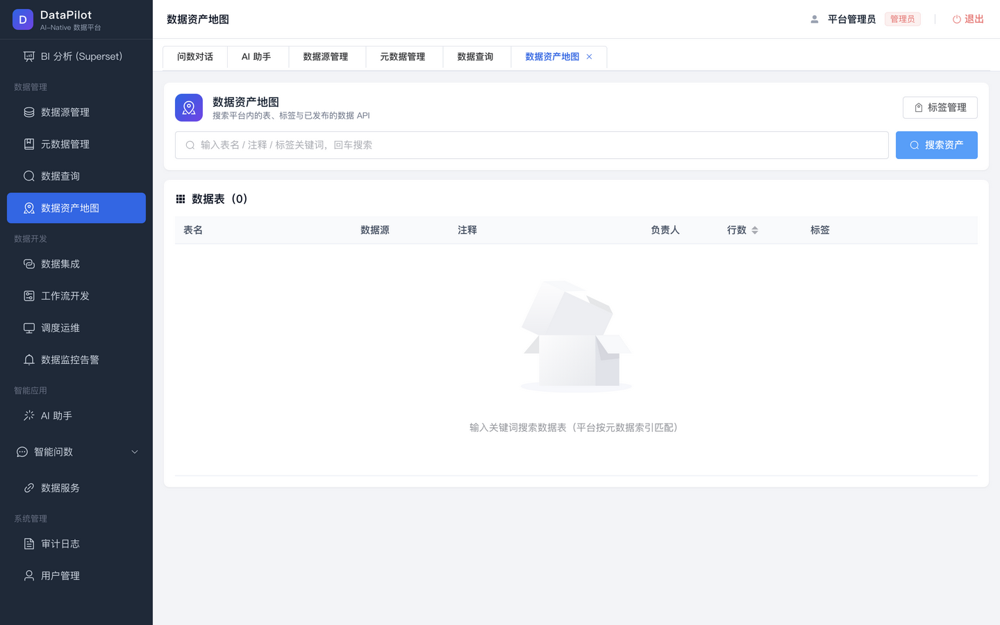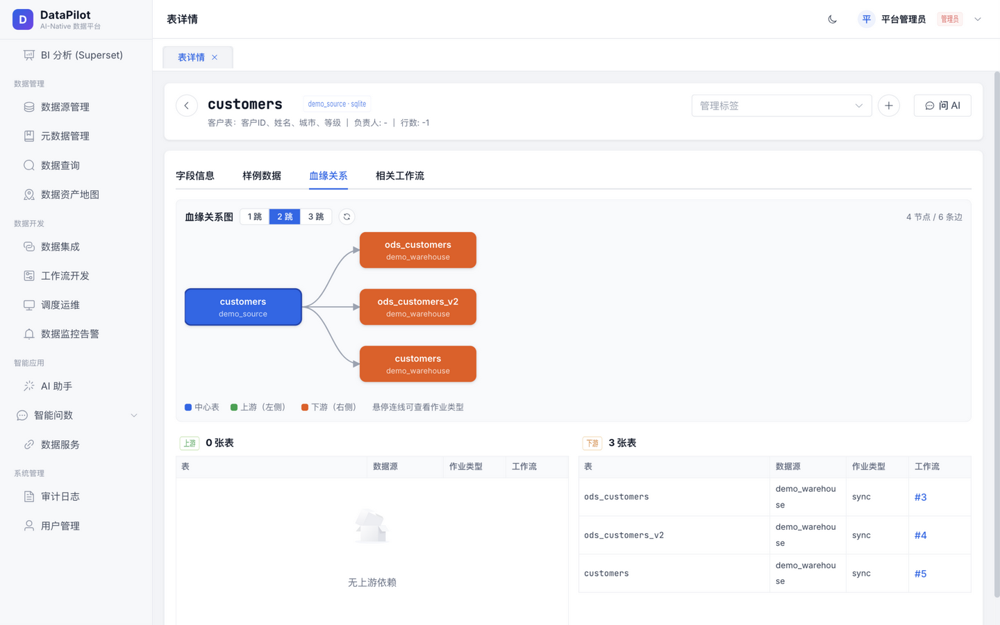</td></tr>
<tr><td colspan="2"><b>数据资产地图（搜索 / 标签）</b> · <b>表详情 + SVG 血缘图</b></td></tr>
<tr><td>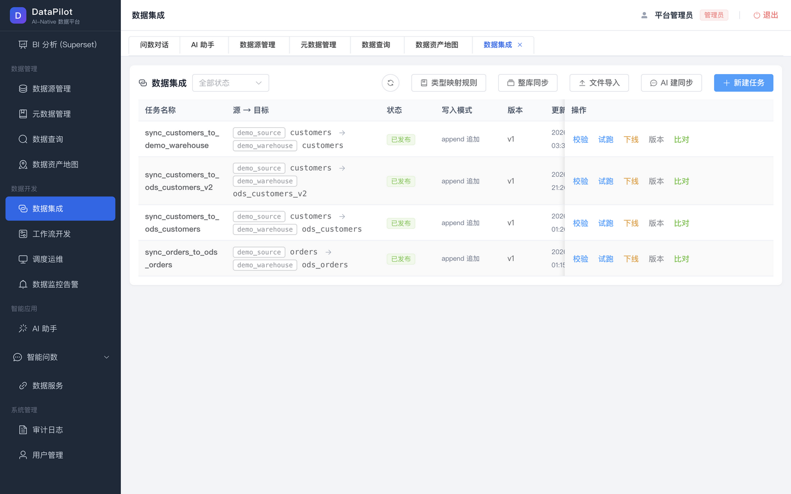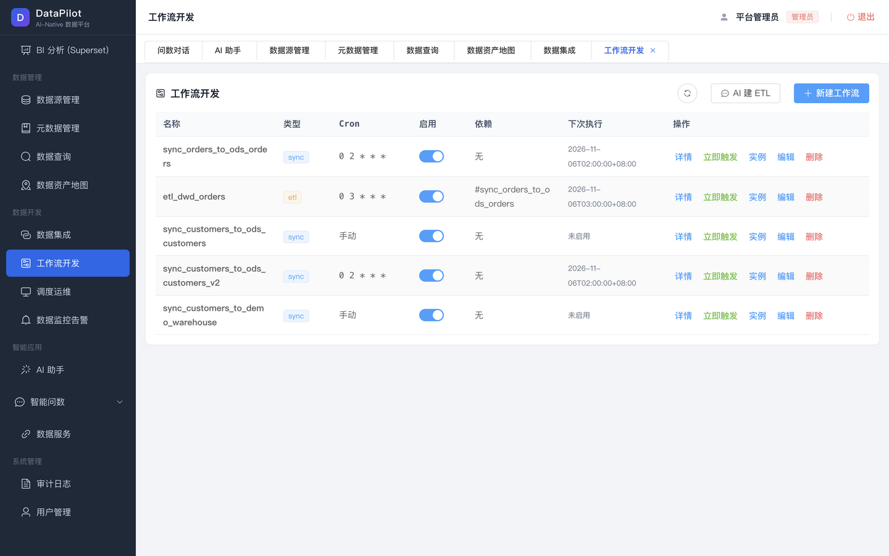</td></tr>
<tr><td colspan="2"><b>数据集成（校验 / 试跑 / 版本化 / 整库同步 / 文件导入 / 数据比对）</b> · <b>工作流开发（多节点拓扑）</b></td></tr>
<tr><td>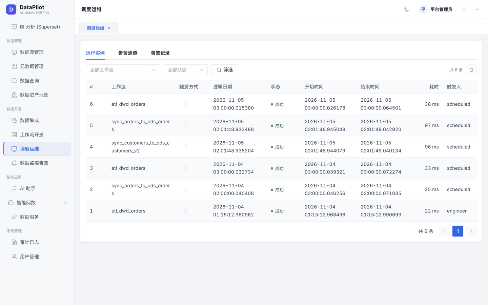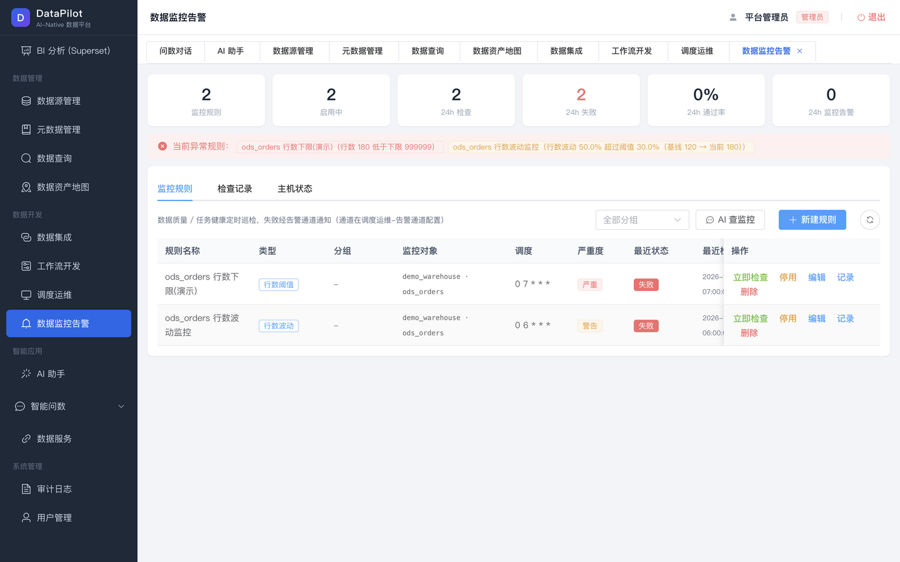</td></tr>
<tr><td colspan="2"><b>调度运维（实例 / 日志 / 重跑 / 告警通道）</b> · <b>数据监控告警（7 类规则 / 趋势图 / 静默窗口）</b></td></tr>
<tr><td>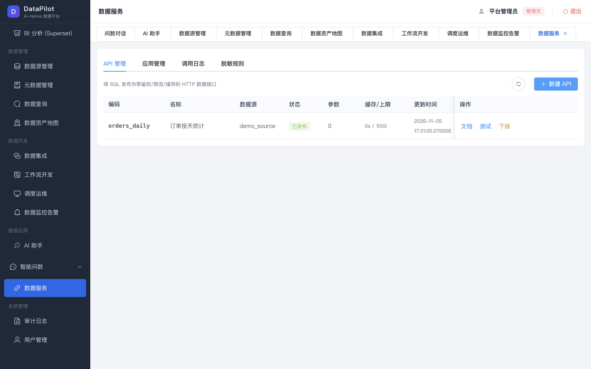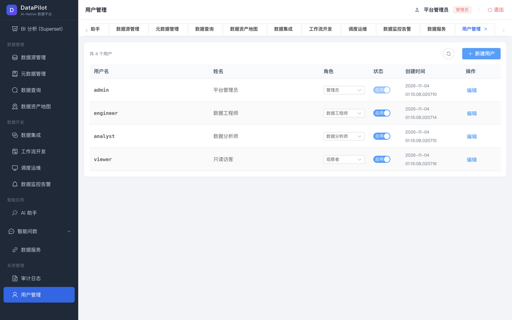</td></tr>
<tr><td colspan="2"><b>数据服务（SQL→API：AK/SK / 限流 / 审计 + 列级脱敏规则）</b> · <b>用户管理（RBAC 四角色）</b></td></tr>
<tr><td>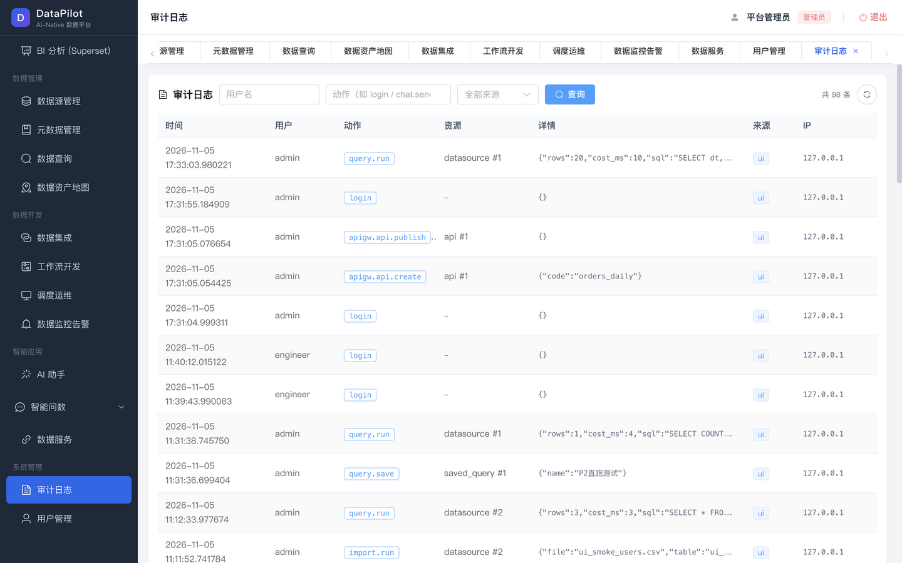</td></tr>
<tr><td><b>审计日志（UI / API / AI 三来源全覆盖）</b></td></tr>
</table>

## 相关文档

- [DEPLOY.md](DEPLOY.md) —— 部署手册（单机/生产/备份恢复/故障排查）
- [docs/design/](docs/design/) —— 全套设计文档（01 架构 · 07 PRD · 08 排期 · 11 对照评估）
- [CONTRACTS.md](CONTRACTS.md) —— API 契约（前端对接）
- [ACCEPTANCE.md](ACCEPTANCE.md) —— 验收记录（含各轮修复清单）

## 架构红线（与设计文档 01/06 一致）

1. **AI 永不直接上线**：create 类工具只写草稿 + 返回确认卡片，用户确认才渲染上线
2. **AI 权限 = 用户权限**：Agent 以登录用户身份调工具，代码层鉴权而非提示词
3. **配置驱动**：调度/任务一切以配置记录为准，渲染由平台完成，全程可审计可回滚
4. **引擎可插拔**：Local→Airflow、内置执行器→DataX、SQLite→Doris，均只换配置不换代码
